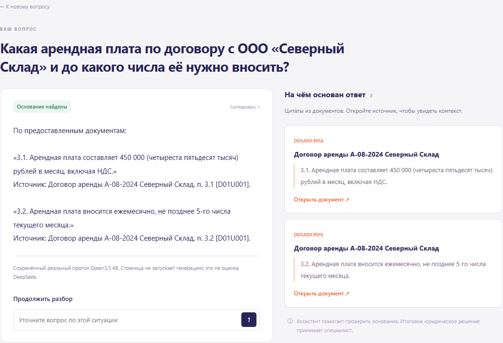

# ОПОРА 2.0

**[Демонстрация](https://antonshkelll.github.io/opora-psb/)** · **[Интерактивная презентация](https://antonshkelll.github.io/opora-psb/deck.html)** · **[Новый комплект](https://github.com/antonshkelll/opora-psb/releases/tag/v2.0.0)**

Юридический ассистент команды VIBESECURITY для Hack&Change 2026, кейс ПСБ. Находит положения договоров и законов, учитывает дату события и показывает проверяемые основания. Учебный проект, не официальный сервис банка.



## Что изменилось после низкого балла

У версии 1 по скриншоту команды: 0,0849 в рейтинге, место 108. Поответного отчёта нет. Причины ошибок закрытого теста неизвестны. Новая версия меняет алгоритм, а не только оформление:

- Модель выбирает 1-4 ID абзацев. Программа сама копирует текст нормы из корпуса. Свободные юридические формулировки модели в ответ не попадают.
- Обычно нужен один запрос вместо обязательной пары «генерация + аудит». Повтор нужен только при ошибке формата или ID.
- Редакция корпоративного регламента, не действовавшая на явно указанную дату, исключается до вызова модели. При сравнении доступны обе редакции.
- Различаются похожие контрагенты. Короткие договоры и статьи сохраняются целиком вместе с исключениями.
- В поиск попадают факты реплик пользователя; прежние ответы ассистента не становятся доказательством.
- Скрипт сохраняет CSV после каждого результата и пишет диагностический отчёт без ключей.

**Новый балл платформы пока не получен.** Полнота поиска, локальные тесты и ответы Qwen не доказывают рост оценки DeepSeek. [Разбор решения и сверка с открытыми главами учебника Changellenge](docs/CASE_AUDIT_V2.md).

## Проверить без установки

Откройте [витрину](https://antonshkelll.github.io/opora-psb/), выберите ситуацию, прочитайте ответ, откройте цитату и полный документ. Можно искать документы по названию.

Витрина показывает **сохранённые ответы реального локального прогона Qwen3.5 4B** на 18 опубликованных вопросах. Она не обращается к модели из браузера и не выдаёт эталонные ответы за генерацию. Произвольные вопросы требуют живого приложения. Ключей и контактов участников на странице нет.

## Воспроизведение

```sh
python fetch_materials.py
python -m unittest discover -s tests -v
python evaluate.py
docker compose up --build -d
```

Скопируйте `.env.example` в `.env` и настройте профиль модели. Контейнер слушает порт 8080. В финальном архиве учебная база уже есть; при сборке из Git она скачивается у организаторов. Сам рантайм использует стандартную библиотеку Python. PDF собирается отдельно через ReportLab.

Для полного локального прогона с Ollama задайте `LLM_PROVIDER=ollama`, `OLLAMA_BASE_URL`, `OLLAMA_MODEL=qwen3.5:4b`, затем `python benchmark_v2.py`. Это длительная проверка на CPU, отдельная от 20-минутного запуска платформы.

Отчёты: [реальные ответы и время](docs/v2-real-demo-report.json), [поиск](docs/v2-retrieval-report.json), [итоги проверки](docs/VERIFICATION_V2.md). Локальная рубрика проверяет часть фактов и нужный документ. Она не равна LLM-судье и не доказывает отсутствие всех ошибок.

## Архитектура

`Документы -> абзацы и цельные короткие статьи -> BM25 -> контрагент и применимая редакция -> выбор ID моделью -> проверка ID -> дословные положения + источник`

21 документ, 171 единица поиска. TXT, MD, DOCX; PDF/OCR в рантайме отсутствуют. Идентификаторы назначаются из загруженного корпуса; готовых ответов на демонстрационные вопросы в сабмите нет. SHA-256 связывает отчёт с очищенной базой.

Модель выбирает тип вывода: факт, да, нет, исправление предпосылки или зависимость от условий. Программа добавляет стандартный текст о нехватке основания. Неверный выбор абзаца и ошибочное «да/нет» всё ещё возможны. Цитата подтверждает текст нормы, но не гарантирует её применимость.

Известная команда-инъекция в записке об архиве удаляется до индексации. Остальные положения сохраняются. Системная инструкция отделяет документы от команд. Это не универсальная защита от всех внедрений.

## Модели

| Профиль | Использование |
|---|---|
| organizer | API и модель организаторов, обязательный профиль `solution.py` |
| ollama | Бесплатная локальная Qwen3.5 4B, без ключей; занимает около 3,3 ГБ на диске D |
| openrouter | Только бесплатные модели `:free` / `openrouter/free`, нужен свой ключ |
| gemini | Нужен свой ключ и проверка доступного тарифа/квот аккаунта |

Бесплатная локальная модель не требует оплаты за токены; используются ресурсы компьютера. Облачные профили без ключей не проверялись. Нет автоматического перехода на платный API. [Настройки и официальные ссылки](docs/MODELS.md).

На соревновании `solution.py` принудительно использует организаторский профиль. Установка Ollama на компьютере не влияет на контейнер проверки. Прямого доступа к DeepSeek организаторов для локального прогона нет.

## Что загружать

**Первый тур: [opora-submit-v2.zip](https://github.com/antonshkelll/opora-psb/releases/download/v2.0.0/opora-submit-v2.zip)**. В корне ровно четыре файла: `solution.py`, `core.py`, `engine_v2.py`, `requirements.txt`.

Финальный комплект: [opora-final-v2.zip](https://github.com/antonshkelll/opora-psb/releases/download/v2.0.0/opora-final-v2.zip): исходники, база, Docker, тесты, документация, PDF и интерактивные материалы. [Порядок сдачи](docs/SUBMISSION.md).

Скрипт читает `questions.csv` и `kb.zip` / `knowledge-base.zip` / `knowledge_base.zip` из `DATA_DIR`; пишет `submission.csv` в рабочий каталог. UTF-8, строго `id,answer`, непустой ответ для каждого ID, до 10000 символов. Между строками история не переносится. Выход сохраняется атомарно, диагностический `run_report.json` не содержит ключей.

Лимиты: 128 МБ ZIP, 20 минут, 8 CPU, 16 ГБ RAM, 5 попыток в сутки. Внутренний бюджет 1120 секунд; 110 секунд на вопрос; до 8 параллельных задач. Обычный ответ требует одного вызова; сетевые повторы и исправление формата могут добавить вызовы.

## Окружение

| Переменная | Назначение |
|---|---|
| DATA_DIR | Каталог входных данных |
| LLM_BASE_URL / BASE_URL / OPENAI_BASE_URL | Прокси организаторов |
| LLM_API_KEY / OPENAI_API_KEY | Служебный ключ |
| LLM_MODEL / GEN_MODEL / OPENAI_MODEL | Имя модели от платформы |
| LLM_PROVIDER | Профиль живого веб-приложения |
| TOP_K / MAX_WORKERS | Количество источников и параллельность |
| ANSWER_TIMEOUT / MAX_TOKENS | Лимиты запроса |
| OLLAMA_BASE_URL / OLLAMA_MODEL / OLLAMA_CONTEXT | Локальная модель |
| PORT | Порт приложения, по умолчанию 8080 |

EMB_MODEL, RERANKER_MODEL, RERANKER_TOP_N и CHUNKER этой реализации не требуются. Действующие ключи исключены из Git. Для другого корпуса нужны повторная оценка поиска и настройка связей документов.

## Команда и внедрение

[Роли участников](docs/TEAM.md) · [Сценарий защиты](docs/DEFENSE.md) · [PDF](https://antonshkelll.github.io/opora-psb/presentation.pdf)

Антон: архитектура, анализ требований и общая приёмка. Марина: юридические сценарии. Ирина: поиск и оценка. Виктор: запуск, API и упаковка. Амина: интерфейс и защита. Это согласованное распределение ответственности, не утверждение о фактически выполненном каждым объёме работ.

Перед банковским внедрением нужны SSO, права доступа, аудит, оценка юристами и защищённое развёртывание. Бесплатным облачным API нельзя передавать реальные банковские данные без отдельного разрешения. Витрина не передаёт вопросы модели; живое приложение передаёт настроенному API вопрос и найденные фрагменты.

Источники: [регламент](https://docs.google.com/document/d/1GjOSBr6xtiweDrMI5Kvcnug4wcbHCzg7n5TJ4UBnuxg/edit), [материалы](https://drive.google.com/drive/folders/1lendasLVlcKUcuM8mOrWKHD-C2dWtm9F), кейс ПСБ. Внешние юридические источники для ответов не используются. Права на учебные материалы остаются у правообладателей.
